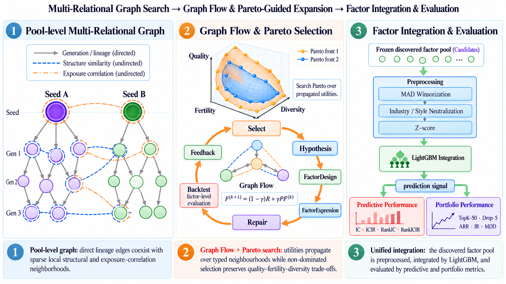

# CosmosAlpha

[English](README.md) | [中文](README_zh-CN.md)

**CosmosAlpha** 是 LLM 驱动的因子挖掘框架，将因子池组织为融合生成谱系、
表达式结构相似性与横截面暴露相关性的**多关系图**。框架通过 **Graph Flow**
传播搜索效用，以 **Pareto 引导选择**权衡质量、繁殖贡献与多样性，指导后续探索。
挖掘出的因子通过 LightGBM 集成，进行预测与组合表现评价。

## 安装

使用 Conda 创建并激活 Python 3.12 环境：

~~~sh
conda create -n cosmosalpha -c conda-forge python=3.12 pip -y
conda activate cosmosalpha
~~~

若已有 `cosmosalpha` 环境，直接激活，无需重建。在克隆后的仓库目录选择普通安装：

~~~sh
python -m pip install ".[model]"
~~~

或 editable 安装：

~~~sh
python -m pip install -e ".[model]"
~~~

model extra 包含 Qlib、pandas 和 LightGBM。仅执行离线 smoke 时，可用
`python -m pip install -e .` 安装核心依赖。

## 数据

从 Zenodo 下载 [data.zip](https://zenodo.org/records/23857833/files/data.zip?download=1)
并在本地解压。在所选挖掘配置和 LightGBM 配置中，将下列三个 Provider 路径
指向解压后的对应目录：

| Provider | 示例目录 | 必需内容 |
|---|---|---|
| 行情 | `~/data/cn_data/qlib_bin` | open、high、low、close、volume、vwap、turn、free_turn、returns |
| 暴露 | `~/data/cn_data/qlib_exposure_bin` | industry_id、log_mkt_cap、行业 manifest |
| Mask | `~/data/cn_data/qlib_mask_bin` | universe_mask、eligible_mask、entry_tradable_mask、exit_tradable_mask |

示例默认使用 CSI300。数据要求与使用限制见[配置说明](docs/configuration.md#data-and-universe)。

## 运行

激活 `cosmosalpha` 环境后，在仓库根目录执行以下命令。
选择下方的挖掘配置，或复制为被 Git 忽略的 `*.local.toml`。

参数含义、默认值与生效范围见[配置说明（英文）](docs/configuration.md)。

### 1. 配置 LLM

在所选挖掘配置的 `[llm]` 中，按以下任一示例替换同名字段，其余配置保留。

**DeepSeek（默认）：**

~~~toml
[llm]
provider = "openai-compatible"
model_alias = "deepseek-flash"
base_url = "https://api.deepseek.com"
~~~

**其他 OpenAI-compatible 服务：**

~~~toml
[llm]
provider = "openai-compatible"
model_alias = "your-model-id"
base_url = "https://your-provider.example/v1"
~~~

填写服务商实际接受的模型 ID 和 API 基础地址；服务须支持 Chat Completions
和 JSON 模式。

在终端设置 API Key：

Bash：

~~~sh
export COSMOSALPHA_LLM_API_KEY='your-api-key'
~~~

PowerShell：

~~~powershell
$env:COSMOSALPHA_LLM_API_KEY = 'your-api-key'
~~~

可通过 `COSMOSALPHA_LLM_BASE_URL` 覆盖 `base_url`。
程序不自动加载 `.env` 文件。

### 2. 因子挖掘

为 `run --config` 选择一份配置：

| 架构 | 配置文件 | 主要参数 |
|---|---|---|
| Graph | [graph_experiment.toml](configs/graph_experiment.toml) | `[graph]` 中的搜索与选择参数 |
| Chain | [chain_experiment.toml](configs/chain_experiment.toml) | `workflow.max_cycles` |
| 并行分支 | [parallel_branches_experiment.toml](configs/parallel_branches_experiment.toml) | `architecture.directions`、`runtime.max_workers`、每分支 Cycle 数 |
| MCTS（单树） | [mcts_experiment.toml](configs/mcts_experiment.toml) | `[mcts]` 中的搜索轮数、探索权重和动态预算 |

并行分支的 `workflow.max_cycles` 对每个研究方向分别生效；MCTS 搜索长度由 `[mcts]` 控制。

先执行无需数据、API Key 或网络请求的安装检查：

~~~sh
python -m cosmosalpha --smoke-loop
~~~

配置好数据和 LLM 后，先预检再挖掘。以下以 Graph 为例，更换配置路径即可使用其他架构：

~~~sh
python -m cosmosalpha run --config configs/graph_experiment.toml --run-id mine-001 --preflight-only
python -m cosmosalpha run --config configs/graph_experiment.toml --run-id mine-001
~~~

预检只检查本地前置条件，不调用 LLM；正式运行会读取真实数据并请求 LLM。
默认 Graph 使用冷启动，最多 100 次扩展尝试、4 个 Worker。
如需使用内置种子池热启动，在 `graph.initialization` 中将 `seed_mode`
改为 `'warm'`；`seed_pool` 已配置为 `'huatai_v1'`。

### 3. 模型训练与评价

~~~sh
python -m cosmosalpha train-lightgbm --config configs/lightgbm_integration.example.toml --source-run-id mine-001 --run-id model-001 --preflight-only
python -m cosmosalpha train-lightgbm --config configs/lightgbm_integration.example.toml --source-run-id mine-001 --run-id model-001
~~~

将 Graph 挖掘结果接入 LightGBM，进行预测与日频组合评价。
预处理、因子选择及回测参数见 [LightGBM 配置说明](docs/lightgbm.md)。

示例挖掘与训练窗口结束于 2019 年 5 月，验证期至 2020 年底，测试期为
2021–2025 年；修改日期时保持时间隔离。

## 输出与恢复

结果位于 `runs/<run-id>/`。挖掘导出 `factor_library/factors.csv`，并保存
结构化对象、因子值和工作流状态。模型运行使用独立目录，保存模型、预测、
信号指标、组合评价报告与因子排除记录。

配置或数据版本变更后使用新的 run ID。Graph、Chain 和并行分支可追加
`--resume` 恢复输入未变的运行。MCTS 每次启动新的搜索，需要使用新的 run ID。
模型运行不覆盖已有目录，重新运行也需要新的 ID。

## 验证与引用

~~~sh
python -m pip install -e '.[dev]'
python -m pytest -q
python -m ruff check .
python -m black --check --workers 1 .
~~~

测试使用固定输入与 Mock；未安装模型依赖时，明确跳过可选 Qlib 适配测试。
CI 在 Linux、Windows 的 Python 3.12 环境执行离线检查。

软件引用见 [CITATION.cff](CITATION.cff)。
源码采用 [MIT 许可证](LICENSE)。另行获取的数据适用各自提供方的条款。
